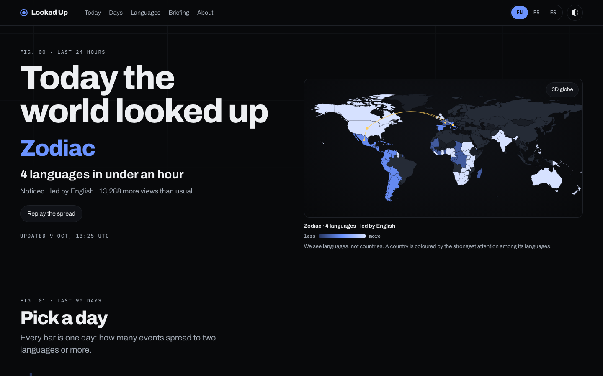
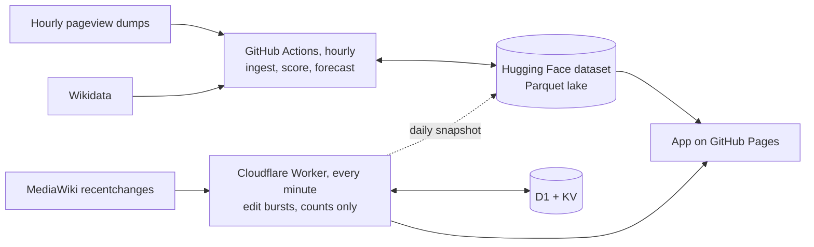

# Looked Up

**What humanity looked up today.** Every hour, Wikimedia publishes how often each Wikipedia article was read. Looked
Up takes 30 language editions (98.5 % of human article views among the 60 largest Wikipedias), joins the same topic
across languages through Wikidata, and turns the reading into attention events: one topic spiking in two or more
languages at once, graded by how far it spread. It forecasts which events will go international, and watches edits by
the minute for what editors are confirming right now. Everything runs on free infrastructure, and every hypothesis
was written down, with its threshold, before the code that tested it.

**Live app: [sbaiii.github.io/looked-up](https://sbaiii.github.io/looked-up/)** in English, French and Spanish ·
case study: [sbaiii.com/projects/looked-up](https://sbaiii.com/projects/looked-up/) ·
dataset: [`Sbaiiiiii/looked-up`](https://huggingface.co/datasets/Sbaiiiiii/looked-up)



## The scorecard

14 pre-registered hypotheses: **2 supported, 7 rejected, 5 inconclusive**. Inconclusive always means the
pre-registered minimum sample was not reached.

| | Expected | Found | Verdict |
|---|---|---|---|
| **H1** Current events | ≥ 70 % of major portal entries within 6 h | 4.3 % (366 / 8,461) | rejected |
| **H2** Lead language | the event country's language leads ≥ 60 % | 40.7 % (77 / 189) | rejected |
| **H3** Automation filter | flags ≥ 90 % of non-events | 2 / 9, under the 20 needed | inconclusive |
| **H4** Spread speed | deaths and disasters spread faster | the reverse: 2.5 h vs 1.0 h | rejected |
| **H1b-1** Deaths | ≥ 60 % detected within 24 h | 32.5 % (159 / 489) | rejected |
| **H1b-2** Earthquakes | ≥ 70 % of M6.5+ within 6 h | 3 / 9 | rejected |
| **H1b-3** Matches | ≥ 90 % within 3 h of kick-off | 2 / 2, under the 5 needed | inconclusive |
| **H2b** Quake language | affected country's language leads ≥ 60 % | 2 / 4, under the 5 needed | inconclusive |
| **H5** Quake delay | median ≤ 4 h | 0 h from 4 quakes, under the 5 needed | inconclusive |
| **H6** Going international | AUC ≥ 0.80, slope 0.8 to 1.2, 1 h after detection | AUC 0.875, slope 0.83 | supported |
| **H7** Fame dominates | sitelinks alone ≥ 70 % of the model's PR AUC | 20 % | rejected |
| **H8** Attention left | ≥ 20 % lower MAE than a decay rule | 26 % lower | supported |
| **H9** Editors first | edit bursts ≥ 60 min before readers | readers first, by a median 106 min | rejected |
| **H10** Live events | 2-language bursts predict reading events, precision ≥ 30 % | none scored yet; needs 100 | inconclusive |

What the data showed instead: English leads only 26.6 % of events; a World Cup final reaches 29 languages in the same
hour while a death spreads over hours; 25 of the 30 largest events the English Current events portal never linked are
real; and an edit burst, though it follows readers, is known 86 minutes before the reading data is published.

Pre-registrations: [Phase 2](docs/prereg_phase2.md) · [2b](docs/prereg_phase2b.md) · [4](docs/prereg_phase4.md) ·
[5](docs/prereg_phase5.md). Results: [Phase 2](docs/analysis/phase2_results.md) ·
[2b](docs/analysis/phase2b_results.md) · [4](docs/analysis/phase4_results.md) · [5](docs/analysis/phase5_results.md).
Decisions and every deviation: [docs/adr/](docs/adr/).

## How it works



- **Readers, hours late and complete:** each newly published hour is added to the lake, scored for events against
  each article's own 28-day baseline, and exported for the app. Tiers: noticed ≥ 2 languages, international ≥ 5,
  planetary ≥ 20.
- **Editors, minutes and partial:** a TypeScript Worker polls each Wikipedia's recent changes and flags articles that
  several editors are rushing to update. It stores counts, never user names.
- **Forecast, the next 24 hours:** LightGBM models, retrained weekly, give each open event a chance of going
  international and the attention it has left.

Operations, workflows and the full command list: [docs/ops.md](docs/ops.md).

**Limitations.** An hour's reading numbers arrive about 3.2 hours after it begins. It sees languages, not countries. Detection
favours the famous. Planetary forecasts rest on 3 test events. **Known limitation:** the Worker's polls run at about
10 ms of CPU (p95 16 ms), over the free plan's 10 ms; no run has been rejected so far (ADR 0033).

## How to run it

```bash
python3.12 -m venv .venv && .venv/bin/pip install -e ".[dev,forecast]"
.venv/bin/pytest                                          # tests (also run in CI)
export HF_TOKEN=...                                       # only to write to the Hub; never commit it
.venv/bin/python -m lookedup.cli hourly --local           # ingest the missing hours into a local lake
.venv/bin/python -m lookedup.cli sync --from 2026-07-09   # or mirror the public lake
.venv/bin/python -m lookedup.cli warehouse build          # dbt: spikes, events, tests
.venv/bin/python -m lookedup.cli evaluate                 # the pre-registered Phase 2 evaluation
.venv/bin/python -m lookedup.cli forecast-evaluate        # the pre-registered forecast backtest
npm ci && npm run serve                                   # the app on http://localhost:4173/
(cd worker && npm ci && npm test)                         # the live Worker's tests
```

Or query the lake straight from DuckDB:

```sql
INSTALL httpfs; LOAD httpfs;
SELECT lang, title, views_desktop + views_mobile AS views
FROM 'hf://datasets/Sbaiiiiii/looked-up/data/hourly/year=2026/month=10/day=06.parquet'
WHERE ts_hour_start = TIMESTAMP '2026-10-06 14:00'
ORDER BY views DESC LIMIT 20;
```

## Data and license

Wikimedia pageviews and Wikidata are CC0, and so is the dataset built from them. The code is MIT, as declared in
`pyproject.toml`. Every request to Wikimedia carries a descriptive User-Agent, as Wikimedia asks.
